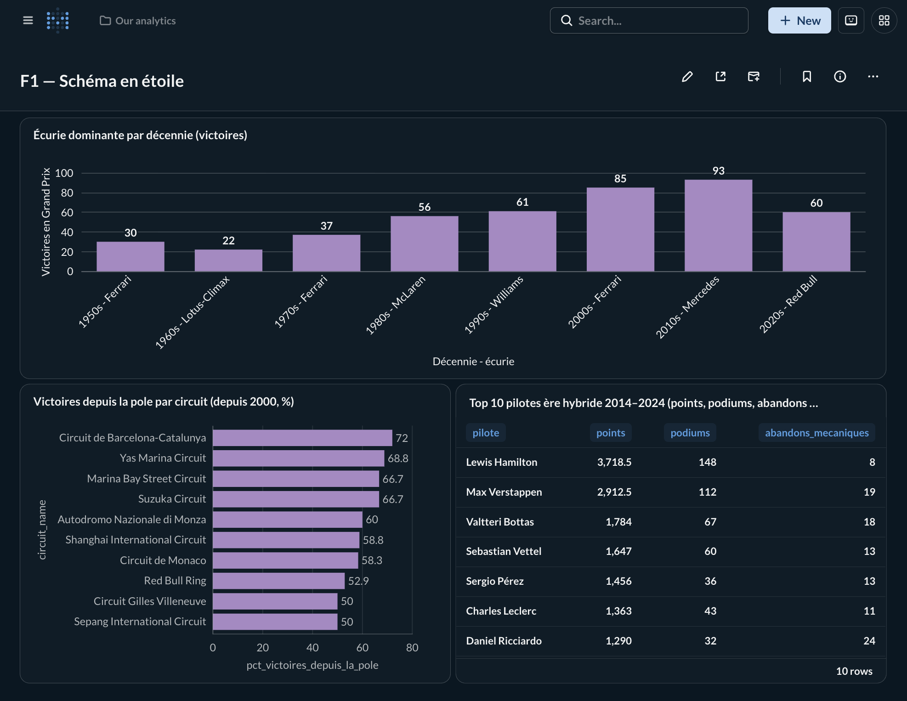

# YNOV-SQL-F1 — Pipeline de données du Championnat du monde de Formule 1 (1950–2024)

Projet SQL et data engineering de bout en bout, construit sur le jeu de données **Formula 1 World Championship (1950–2024)** (Ergast F1 / Kaggle) pour le cours **SQL & Data Engineering d'YNOV** : d'une base PostgreSQL normalisée, en passant par le SQL avancé et l'optimisation de requêtes, jusqu'à un pipeline **dbt** testé et documenté.

| Étape | Ce que nous avons construit | Où |
| :--- | :--- | :--- |
| 1. Base relationnelle | 14 tables normalisées (3FN), 23 clés étrangères, 701 433 lignes, schéma en étoile construit à la main | [`sql/Other SQL/`](sql/Other%20SQL/), [`dump/`](dump/), [`docs/`](docs/) |
| 2. Tâche 1 — SQL avancé | 7 questions métier avec classement, LAG, NTILE, fenêtres glissantes (`ROWS BETWEEN`), CTE récursive, CTE enchaînées, sur les deux modèles | [`sql/assignments/tache_1/`](sql/assignments/tache_1/) |
| 3. Tâche 2 — Performance | Données multipliées par 50 (1,46 M de lignes), `EXPLAIN ANALYZE` avant/après (médiane de 3 exécutions), 4 index, jusqu'à **×387** plus rapide | [`sql/assignments/tache_2/`](sql/assignments/tache_2/) |
| 4. Pipeline dbt | sources → staging → intermediate → marts, 385 vérifications réussies, documentation générée | [`f1_dbt/`](f1_dbt/) |
| 5. Schéma en étoile | Étoile dbt dans le schéma `dw_star` : 1 table de faits + 5 dimensions (mêmes colonnes que le `dw` construit à la main), 3 questions métier | [`docs/schema_etoile.png`](docs/schema_etoile.png), [`sql/assignments/tache_3/`](sql/assignments/tache_3/) |
| 6. Analyse critique | Limites, choix discutables et prochaines étapes | [section 6](#6-analyse-critique) |

**Stack :** PostgreSQL 16 · dbt-core 1.12 + dbt-postgres · dbt_utils · Metabase · Python 3.13 · Git
**Licence :** CC0 domaine public ([Kaggle / Ergast F1](https://www.kaggle.com/datasets/rohanrao/formula-1-world-championship-1950-2020))

---

## 1. Base de données relationnelle

Les 14 fichiers CSV bruts ont été chargés dans PostgreSQL sous forme de modèle normalisé (3FN) dans le schéma `public` ([`public.sql`](sql/Other%20SQL/public.sql)).

- **14 tables** reliées par **23 clés étrangères** appliquées
- **701 433 lignes** sur **75 saisons** (`1950-05-13` → `2024-12-08`)
- **27 index** (14 clés primaires + 13 index B-Tree analytiques)
- Les 6 critères du cours sont remplis (tables liées, dimension temporelle, catégories, hiérarchie, volume, licence ouverte) et 100 % des lignes des CSV se retrouvent dans la base : voir le [rapport de validation](docs/validation_report.md)

| Table | Lignes | Description |
| :--- | ---: | :--- |
| `seasons` | 75 | Saisons du championnat (1950–2024) |
| `circuits` | 77 | Circuits avec ville, pays, coordonnées, altitude |
| `constructors` | 212 | Écuries / constructeurs et nationalités |
| `drivers` | 861 | Pilotes avec code, numéro, date de naissance, nationalité |
| `status` | 139 | Statuts d'arrivée et d'abandon |
| `races` | 1 125 | Grands Prix, manches, dates |
| `constructor_results` | 12 625 | Points marqués par chaque écurie à chaque course |
| `constructor_standings` | 13 391 | Classement du championnat constructeurs après chaque course |
| `driver_standings` | 34 863 | Classement du championnat pilotes après chaque course |
| `qualifying` | 10 494 | Positions en qualification et temps Q1/Q2/Q3 |
| `results` | 26 759 | Résultats de course : grille, position, points, meilleur tour, statut |
| `sprint_results` | 360 | Résultats des courses sprint (depuis 2021) |
| `pit_stops` | 11 371 | Tour, heure et durée des arrêts aux stands (depuis 2011) |
| `lap_times` | 589 081 | Positions et temps tour par tour (depuis 1996) |
| **Total** | **701 433** | |

**Schéma en étoile construit à la main** ([`dw.sql`](sql/Other%20SQL/dw.sql)) : un script ELT qui construit un schéma `dw` à partir de `public` sans le modifier : 1 table de faits (`fact_race_results`, grain = un pilote dans un Grand Prix, 26 759 lignes) et 5 dimensions (`dim_date`, `dim_driver`, `dim_constructor`, `dim_circuit`, `dim_status`). Les arrêts aux stands sont agrégés par pilote et par course avant la jointure, pour que les lignes de résultats ne soient jamais dupliquées.

Diagrammes : [diagramme ER 3FN](docs/f1_without_star_schema.drawio) ([PNG](docs/Without%20Star.png)) · [Schéma en étoile](docs/f1_star_schema.drawio) ([PNG](docs/Star.png)) · Choix de conception : [Défense des choix de base de données](docs/db_choices_defense.md)

---

## 2. Tâche 1 — SQL avancé : fonctions de fenêtrage et CTE

Les mêmes questions métier sont traitées sur le modèle 3FN ([`queries_non_star.sql`](sql/assignments/tache_1/queries_non_star.sql)) et sur le schéma en étoile ([`queries_star.sql`](sql/assignments/tache_1/queries_star.sql)), pour comparer les deux modèles.

| # | Question métier | Technique |
| :--- | :--- | :--- |
| 1 | Top 3 des pilotes par écurie selon le total de points | `ROW_NUMBER() OVER (PARTITION BY …)` + CTE |
| 2 | Évolution des points d'un mois sur l'autre (%) | `LAG` + `DATE_TRUNC` |
| 3 | Pilotes répartis en 4 quartiles selon le total de points | `NTILE(4)` |
| 4 | Chemin complet de chaque circuit (pays > ville > circuit) | `WITH RECURSIVE` |
| 5 | Nombre moyen de jours entre deux courses consécutives d'un pilote | `LAG` + `PARTITION BY` |
| 6 | Part (%) des statuts d'arrivée par décennie (schéma en étoile) | `SUM() OVER (PARTITION BY decade)` + CTE |
| 7 | Cumul des points et moyenne mobile sur 3 courses, top 3 des pilotes de 2023 | `SUM() OVER (… ROWS BETWEEN UNBOUNDED PRECEDING AND CURRENT ROW)`, `AVG() OVER (… ROWS BETWEEN 2 PRECEDING AND CURRENT ROW)` |

Rédactions : [les 7 requêtes expliquées avec leurs résultats](sql/assignments/tache_1/tache_1_cte_queries.md) · [Conception du schéma en étoile : grain, dimension temporelle, transformations, comparaison des modèles](sql/assignments/tache_1/star_schema.md)

---

## 3. Tâche 2 — Montée en volume, `EXPLAIN ANALYZE` et indexation

Script : [`tache_2_indexing_benchmark.sql`](sql/assignments/tache_2/tache_2_indexing_benchmark.sql) · Rapport : [`benchmark_results.md`](sql/assignments/tache_2/benchmark_results.md)

- **Montée en volume :** le schéma en étoile est copié **×50** dans un schéma `benchmark` séparé avec `CROSS JOIN generate_series(1, 50)` (`public` et `dw` ne sont pas modifiés). Les clés sont décalées (`key + (copy_num - 1) * 100000`), donc chaque clé primaire et étrangère reste unique et les jointures ne dupliquent aucune ligne : **1 458 650 lignes** (~208 Mo), dont 1 337 950 dans la table de faits.
- **Index :** clés primaires sur les 6 tables, un B-Tree simple sur `driver_key`, un B-Tree composite sur `(constructor_key, circuit_key)`, un B-Tree partiel sur `driver_key WHERE is_win = 1` (512 ko) et un B-Tree couvrant `(constructor_key) INCLUDE (driver_key, date_key, points)` pour la requête avec fonction de fenêtrage.
- **Résultats** (`EXPLAIN (ANALYZE, BUFFERS)`, médiane de 3 exécutions, avant = sans index) :

| Requête | Avant | Opérateur avant | Après | Opérateur après | Gain |
| :--- | :--- | :--- | :--- | :--- | :---: |
| A. Trouver un pilote précis (`fact ⋈ driver ⋈ constructor`) | 33,45 ms · 19 334 buffers | Seq Scan | 1,85 ms · 252 buffers | Index Scan | **×18,1** |
| B. Trouver une écurie sur un circuit (`fact ⋈ driver`) | 228,21 ms · 109 813 buffers | Seq Scan | 0,59 ms · 707 buffers | Index Scan | **×386,8** |
| C. Compter les victoires d'un pilote (`fact ⋈ date ⋈ circuit`) | 61,49 ms · 25 728 buffers | Seq Scan | 0,25 ms · 697 buffers | Index Scan (partiel) | **×246,0** |
| D. Fonction de fenêtrage : `RANK() OVER (PARTITION BY year …)` des pilotes d'une écurie | 59,45 ms · 21 916 buffers | Seq Scan | 14,57 ms · 1 542 buffers | Index Only Scan (couvrant) | **×4,1** |

Les index remplacent le parcours complet de la table de faits (1,34 M de lignes) et réduisent les lectures de buffers de 93 à 99 %. L'index partiel apporte un gros gain pour seulement 512 ko. La requête avec fonction de fenêtrage gagne moins : l'index supprime le parcours complet, mais la jointure, l'agrégation et le tri nécessaires au `RANK()` restent. Méthode complète, exécutions détaillées et limites : [`benchmark_results.md`](sql/assignments/tache_2/benchmark_results.md).

---

## 4. Pipeline dbt

Le projet [`f1_dbt/`](f1_dbt/) reconstruit la couche analytique sous forme de pipeline testé et documenté, des tables 3FN brutes (OLTP) jusqu'aux tables prêtes pour l'analyse (OLAP) :

```text
sources (public.*)  ->  staging (stg_)  ->  intermediate (int_)   ->  marts (dim_ / fct_)
   14 tables brutes     14 vues            8 modèles ephemeral         tables pour l'analyse / BI
                        renommage, typage, jointures + logique métier  faits et dimensions
                        nettoyage          (agréger avant de joindre)  avec un grain déclaré
```

| Couche | Matérialisation | Modèles |
| :--- | :--- | :--- |
| Sources | — | [`_sources.yml`](f1_dbt/models/staging/_sources.yml) déclare les 14 tables de `public` comme source `f1` |
| Staging | `view` | 14 modèles `stg_f1__<table>` : renommage (`date` → `date_race`, `grid` → `grid_position`…), typage (points → numeric, coordonnées → `numeric(9,6)`), nettoyage (trim, upper), `position_text` transformé en code `classification_status`. Ni jointure, ni agrégation. |
| Intermediate | `ephemeral` | `int_race_results_enriched` (résultats + courses + arrêts aux stands + temps au tour, avec positions gagnées, vainqueur, podium, non classé, points marqués, tours en tête), `int_pit_stops_per_driver_race`, `int_lap_times_per_driver_race`, `int_qualifying_vs_race`, `int_sprint_results_enriched`, `int_driver_season_standings`, `int_constructor_season_standings`, `int_constructor_race_results` |
| Marts — `star/` | `table` (schéma `dw_star`) | Le schéma en étoile : `fact_race_results` + `dim_date`, `dim_driver`, `dim_constructor`, `dim_circuit`, `dim_status` (voir section 5) |
| Marts — `analytics/` | `table` (schéma `dw`) | Dimensions : `dim_drivers`, `dim_constructors`, `dim_circuits`, `dim_races`, `dim_date` (table `dim_calendar`, une ligne par jour). Faits : `fct_race_results`, `fct_sprint_results`, `fct_constructor_race_results`. Tables agrégées : `fct_driver_season`, `fct_constructor_season`, `fct_circuit_stats`, `fct_pit_stop_strategy`, `fct_teammate_head_to_head` |

Chaque modèle a une description ; chaque mart indique son **grain** (ce que représente une ligne) dans un commentaire et dans sa description.

**Tests** — `dbt build` exécute **385 vérifications (modèles + tests), toutes réussies** :

| Couche | Tests |
| :--- | :--- |
| Sources | `unique` + `not_null` sur chaque clé primaire, unicité de la clé composée sur `lap_times` / `pit_stops` (`dbt_utils`), `accepted_values` sur chaque colonne à liste fermée (`position_text`, `constructor_results.status`) |
| Staging | `unique` + `not_null` sur chaque clé primaire, `accepted_values` sur les codes de statut, `relationships` sur les 23 clés étrangères |
| Intermediate | `relationships` vers chaque entité jointe, aucun doublon après les jointures (`unique` sur la clé du grain) |
| Marts | `unique` + `not_null` sur la clé du grain et sur chaque clé de dimension, `relationships` de chaque table de faits vers `dim_date` et vers chacune de ses dimensions |
| Personnalisés ([`tests/`](f1_dbt/tests/)) | Même nombre de lignes qu'en staging après les jointures (4), totaux d'arrêts aux stands et de temps au tour cohérents avec le staging (2), exactement un pilote champion et une écurie championne par saison (2) |

---

## 5. Schéma en étoile


Conçu sur papier avec les 4 étapes de Kimball, validé en cours, puis construit dans dbt ([`models/marts/star/`](f1_dbt/models/marts/star/)) dans son propre schéma `dw_star`. Il reproduit l'étoile `dw` construite à la main, avec les mêmes tables et colonnes, désormais générées et testées par dbt ; nous avons vérifié que les valeurs sont identiques à celles de `dw`.

- **Processus métier :** le résultat d'un pilote dans un Grand Prix.
- **Grain :** une ligne de `fact_race_results` = un pilote × un Grand Prix (`result_key`), 26 759 lignes.
- **Dimensions :** `dim_date` (une ligne par Grand Prix : date, année, décennie, trimestre, mois, manche, nom de la course), `dim_driver`, `dim_constructor`, `dim_circuit`, `dim_status` (139 statuts regroupés en 5 catégories).
- **Faits / mesures :** `grid`, `position_order`, `positions_gained`, `points`, `laps`, `milliseconds`, `fastest_lap_speed`, `is_win`, `is_podium`, `is_dnf`, `pit_stop_count`, `total_pit_ms`.
- **Tests :** `unique` + `not_null` sur chaque clé, `relationships` de la table de faits vers les 5 dimensions, `accepted_values` sur les indicateurs 0/1 et les catégories de statut, nombre de lignes de la table de faits = nombre de lignes de l'intermediate.

**3 questions métier** traitées avec des requêtes simples sur l'étoile ([`star_business_questions.sql`](sql/assignments/tache_3/star_business_questions.sql)) :

| # | Question | Réponse |
| :--- | :--- | :--- |
| 1 | Quelle écurie a dominé chaque décennie (victoires) ? | Ferrari (années 1950), Lotus-Climax (années 1960), Ferrari (années 1970), McLaren (années 1980), Williams (années 1990), Ferrari (années 2000), Mercedes (années 2010), Red Bull (années 2020) |
| 2 | Sur quels circuits la pole position est-elle la plus décisive (depuis 2000) ? | Barcelone (72 % des victoires depuis la pole), Yas Marina (68,8 %), Marina Bay et Suzuka (66,7 %) |
| 3 | Meilleurs marqueurs de l'ère hybride (2014–2024), et combien de courses perdues sur casse mécanique ? | Hamilton 3 718,5 pts / 148 podiums / 8 abandons mécaniques, Verstappen 2 912,5 / 112 / 19, Bottas 1 784 / 67 / 18 |

**Tableau de bord Metabase** — les 3 questions sur l'étoile, connecté au schéma `dw_star` (Metabase tourne en local sur `localhost:3000`) :



---

## 6. Analyse critique

Ce que nous assumons, et ce que nous ferions ensuite.

**Limites**

| Limite | Pourquoi |
| :--- | :--- |
| Données figées : aucun test de fraîcheur possible | La source est un instantané, sans date de chargement ; `dbt source freshness` n'a rien à mesurer. |
| Barème de points changé selon les époques : comparer les décennies est biaisé | Une victoire valait 8 points dans les années 1950 et 25 aujourd'hui, donc les totaux de points favorisent les pilotes récents. |
| Voitures partagées des années 1950 : 2 résultats pour un pilote dans une course | Deux pilotes pouvaient partager une voiture : 85 cas d'un pilote avec 2 résultats dans la même course, et parfois 2 vainqueurs crédités. |
| Fonction de fenêtrage : gain limité à ×4,1 | L'index supprime le parcours complet, mais le tri du `RANK()` reste (requête D de la tâche 2). |

**Choix discutables**

| Choix | Ce qu'on en pense |
| :--- | :--- |
| `dim_date` au grain de la course, pas du jour | Suffisant car le grain du fait est un résultat de course, mais le cours montre une dimension au jour (elle existe côté `analytics/` : `dim_calendar`). |
| Clés naturelles plutôt que clés de substitution dans `dw_star` | Plus simple et lisible ; des clés de substitution seraient nécessaires pour historiser les dimensions (SCD2). |
| Deux étoiles : `dw` écrite à la main, `dw_star` par dbt | `dw_star` reproduit `dw` avec dbt (valeurs vérifiées identiques) ; garder les deux montre la démarche mais fait doublon. |
| Catégorie « Mechanical / Other DNF » approximative | Les 139 statuts sont regroupés en 5 catégories à la main ; certains statuts sont ambigus. |

**Et ensuite**

- Ajouter les faits qualifications, sprints et tours dans une constellation (plusieurs tables de faits partageant les mêmes dimensions).
- Normaliser les points pour comparer les époques.
- Ajouter des snapshots SCD2 et des tests `dbt-expectations`.
- Lancer `dbt build` en intégration continue à chaque modification.

---

## Démarrage rapide

### 1. Restaurer la base de données

```bash
createdb f1
pg_restore -d f1 --no-owner --no-privileges dump/f1.dump
```

*(Ajoutez `-U postgres` ou `-p <port>` si votre PostgreSQL utilise un utilisateur ou un port différent de ceux par défaut.)* Avec pgAdmin 4 : créez une base `f1` vide, clic droit dessus → **Restaurer…** → sélectionnez `dump/f1.dump`.

### 2. Lancer le pipeline dbt

Installez `dbt-postgres` dans un environnement virtuel (`python -m venv .venv && source .venv/bin/activate && pip install dbt-postgres`), puis créez `~/.dbt/profiles.yml` (gardé en dehors du repo) :

```yaml
f1_dbt:
  target: dev
  outputs:
    dev:
      type: postgres
      host: localhost
      port: 5432          # votre port PostgreSQL
      user: <votre_utilisateur>
      password: <votre_mot_de_passe>
      dbname: f1
      schema: dw          # schéma où dbt crée ses modèles
      threads: 4
```

```bash
cd f1_dbt
dbt debug            # vérifie la config et la connexion : "All checks passed!"
dbt deps             # installe dbt_utils
dbt build            # exécute tous les modèles et tous les tests
dbt docs generate    # génère le site de documentation
dbt docs serve       # l'ouvre sur localhost:8080 (graphe de lignage : bouton en bas à droite)
```

Sélections utiles : `dbt build -s staging` (une couche), `dbt run -s stg_f1__drivers` (un modèle), `dbt build -s +fct_race_results` (un modèle et ses parents), `dbt show -s fct_race_results` (aperçu des lignes).

---

## Structure du dépôt

```text
YNOV-SQL-F1/
├── README.md
├── data/csv/                          # 14 fichiers CSV sources bruts (21 Mo)
├── dump/f1.dump                       # Dump PostgreSQL compressé (schémas public + dw + dw_star)
├── sql/
│   ├── Other SQL/
│   │   ├── public.sql                 # DDL 3FN : tables, clés primaires, clés étrangères, index
│   │   └── dw.sql                     # ELT du schéma en étoile construit à la main (public -> dw : 1 fait + 5 dims)
│   └── assignments/
│       ├── tache_1/                   # Fonctions de fenêtrage et CTE (3FN et schéma en étoile)
│       ├── tache_2/                   # Benchmark de montée en volume et d'indexation
│       └── tache_3/                   # 3 questions métier sur le schéma en étoile
├── f1_dbt/                            # Projet dbt
│   ├── dbt_project.yml  packages.yml
│   ├── models/
│   │   ├── staging/                   # _sources.yml, _staging.yml, 14 stg_f1__*.sql
│   │   ├── intermediate/              # _intermediate.yml, 8 int_*.sql
│   │   └── marts/
│   │       ├── star/                  # schéma en étoile -> schéma dw_star (1 fait + 5 dims, mêmes colonnes que dw)
│   │       └── analytics/             # autres marts -> schéma dw (dim_*, fct_*, stats par saison / circuit)
│   ├── tests/                         # 8 tests personnalisés
│   └── macros/  seeds/  snapshots/
└── docs/
    ├── f1_without_star_schema.drawio  # Diagramme ER 3FN (14 tables, 23 clés étrangères)
    ├── f1_star_schema.drawio          # Diagramme du schéma en étoile (1 fait, 5 dims)
    ├── Star.png  Without Star.png     # Exports PNG
    ├── schema_etoile.png              # Schéma en étoile dbt (1 fait, 5 dimensions)
    ├── metabase_dashboard.png         # Tableau de bord Metabase sur l'étoile (3 questions métier)
    ├── validation_report.md           # 6 critères du cours + correspondance des lignes
    └── db_choices_defense.md          # Choix de conception et préparation aux questions
```

---

## Licence et attribution

Jeu de données : [Formula 1 World Championship (1950–2020)](https://www.kaggle.com/datasets/rohanrao/formula-1-world-championship-1950-2020) par Vopani (rohanrao), issu de l'**Ergast Developer API** — **CC0 : domaine public**.
