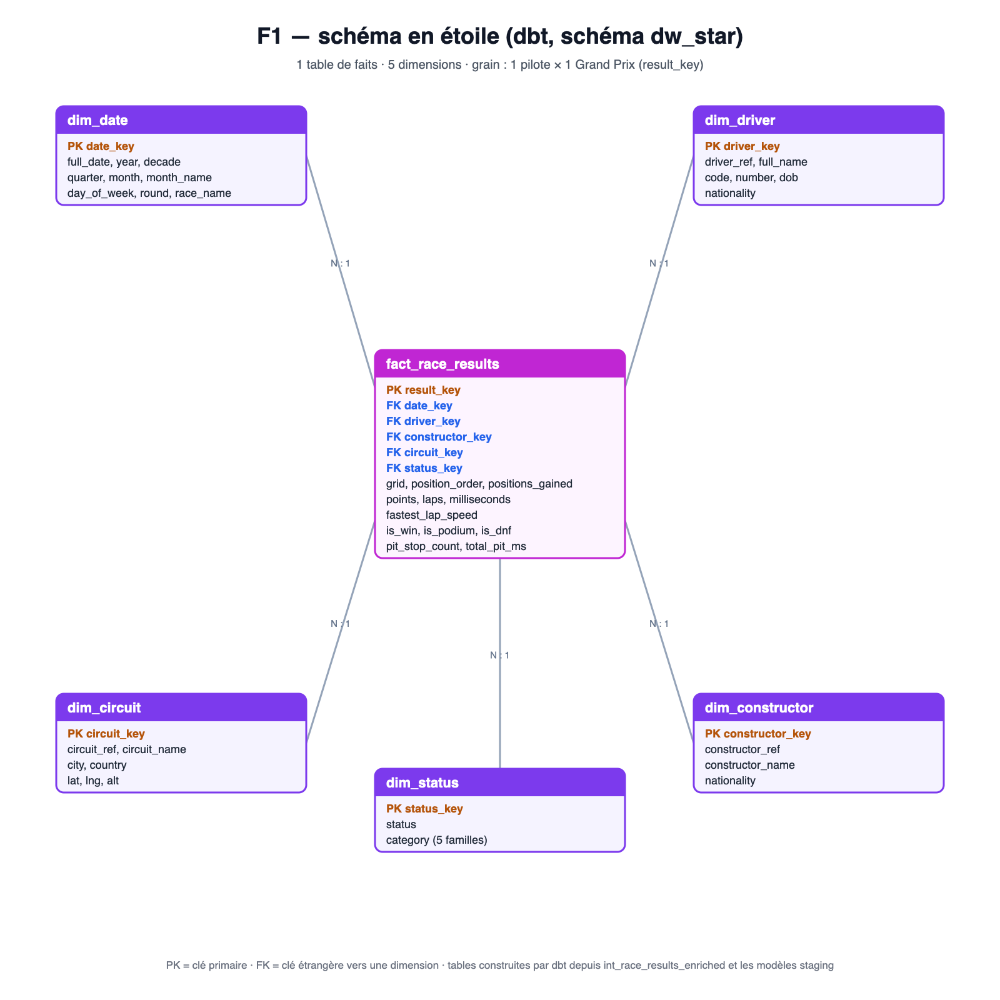

# YNOV-SQL-F1 — Formula 1 World Championship Data Pipeline (1950–2024)

End-to-end SQL & data engineering project built on the **Formula 1 World Championship (1950–2024)** dataset (Ergast F1 / Kaggle) for the **YNOV SQL & Data Engineering** course: from a normalized PostgreSQL database, through advanced SQL and query optimization, to a tested and documented **dbt** pipeline.

| Step | What we built | Where |
| :--- | :--- | :--- |
| 1. Relational database | 14 normalized tables (3NF), 23 foreign keys, 701,433 rows, hand-built star schema | [`sql/Other SQL/`](sql/Other%20SQL/), [`dump/`](dump/), [`docs/`](docs/) |
| 2. Tâche 1 — Advanced SQL | 6 business questions with window functions, recursive CTE, chained CTEs, on both models | [`sql/assignments/tache_1/`](sql/assignments/tache_1/) |
| 3. Tâche 2 — Performance | Data scaled ×50 (1.46 M rows), `EXPLAIN ANALYZE` before/after, 3 indexes, up to **441×** faster | [`sql/assignments/tache_2/`](sql/assignments/tache_2/) |
| 4. dbt pipeline | sources → staging → intermediate → marts, 385 passing checks, generated docs | [`f1_dbt/`](f1_dbt/) |
| 5. Star schema | dbt star in schema `dw_star`: 1 fact + 5 dimensions (same columns as the hand-built `dw`), 3 business questions | [`docs/schema_etoile.png`](docs/schema_etoile.png), [`sql/assignments/tache_3/`](sql/assignments/tache_3/) |

**Stack:** PostgreSQL 16 · dbt-core 1.12 + dbt-postgres · dbt_utils · Python 3.13 · Git
**License:** CC0 Public Domain ([Kaggle / Ergast F1](https://www.kaggle.com/datasets/rohanrao/formula-1-world-championship-1950-2020))

---

## 1. Relational Database

The 14 raw CSV files were loaded into PostgreSQL as a normalized (3NF) model in the `public` schema ([`public.sql`](sql/Other%20SQL/public.sql)).

- **14 tables** linked by **23 enforced foreign keys**
- **701,433 rows** across **75 seasons** (`1950-05-13` → `2024-12-08`)
- **27 indexes** (14 primary keys + 13 analytical B-Tree indexes)
- All 6 course criteria met (linked tables, time dimension, categories, hierarchy, volume, open license) and 100% CSV-to-database row parity: see [Validation Report](docs/validation_report.md)

| Table | Rows | Description |
| :--- | ---: | :--- |
| `seasons` | 75 | Championship seasons (1950–2024) |
| `circuits` | 77 | Circuits with city, country, coordinates, altitude |
| `constructors` | 212 | Teams / constructors and nationalities |
| `drivers` | 861 | Drivers with code, number, date of birth, nationality |
| `status` | 139 | Finish and retirement statuses |
| `races` | 1,125 | Grand Prix events, rounds, dates |
| `constructor_results` | 12,625 | Points scored by each constructor per race |
| `constructor_standings` | 13,391 | Constructor championship standings after each race |
| `driver_standings` | 34,863 | Driver championship standings after each race |
| `qualifying` | 10,494 | Qualifying positions and Q1/Q2/Q3 times |
| `results` | 26,759 | Race results: grid, position, points, fastest lap, status |
| `sprint_results` | 360 | Sprint race results (from 2021) |
| `pit_stops` | 11,371 | Pit stop lap, time and duration (from 2011) |
| `lap_times` | 589,081 | Lap-by-lap positions and times (from 1996) |
| **Total** | **701,433** | |

**Hand-built star schema** ([`dw.sql`](sql/Other%20SQL/dw.sql)): an ELT script that builds a `dw` schema from `public` without changing it: 1 fact table (`fact_race_results`, grain = one driver in one Grand Prix, 26,759 rows) and 5 dimensions (`dim_date`, `dim_driver`, `dim_constructor`, `dim_circuit`, `dim_status`). Pit stops are aggregated per driver and race before joining so result rows are never duplicated.

Diagrams: [3NF ER diagram](docs/f1_without_star_schema.drawio) ([PNG](docs/Without%20Star.png)) · [Star schema](docs/f1_star_schema.drawio) ([PNG](docs/Star.png)) · Design choices: [Database Choices Defense](docs/db_choices_defense.md)

---

## 2. Tâche 1 — Advanced SQL: Window Functions & CTEs

The same business questions are answered on the 3NF model ([`queries_non_star.sql`](sql/assignments/tache_1/queries_non_star.sql)) and on the star schema ([`queries_star.sql`](sql/assignments/tache_1/queries_star.sql)), to compare both models.

| # | Business question | Technique |
| :--- | :--- | :--- |
| 1 | Top 3 drivers per constructor by total points | `ROW_NUMBER() OVER (PARTITION BY …)` + CTE |
| 2 | Month-over-month evolution of points (%) | `LAG` + `DATE_TRUNC` |
| 3 | Drivers split into 4 quartiles by total points | `NTILE(4)` |
| 4 | Full path of each circuit (country > city > circuit) | `WITH RECURSIVE` |
| 5 | Average days between two consecutive races of a driver | `LAG` + `PARTITION BY` |
| 6 | Share (%) of finish statuses per decade (star schema) | `SUM() OVER (PARTITION BY decade)` + CTEs |

Write-ups: [6 queries explained with results](sql/assignments/tache_1/tache_1_cte_queries.md) · [Star schema design: grain, time dimension, transformations, model comparison](sql/assignments/tache_1/star_schema.md)

---

## 3. Tâche 2 — Scaling, `EXPLAIN ANALYZE` & Indexing

Script: [`tache_2_indexing_benchmark.sql`](sql/assignments/tache_2/tache_2_indexing_benchmark.sql) · Report: [`benchmark_results.md`](sql/assignments/tache_2/benchmark_results.md)

- **Scaling:** the star schema is copied **×50** into a separate `benchmark` schema with `CROSS JOIN generate_series(1, 50)` (`public` and `dw` untouched). Keys are shifted (`key + (copy_num - 1) * 100000`), so every PK/FK stays unique and joins have no fan-out: **1,458,650 rows** (~208 MB), 1,337,950 of them in the fact table.
- **Indexes:** primary keys on all 6 tables, a simple B-Tree on `driver_key`, a composite B-Tree on `(constructor_key, circuit_key)`, and a partial B-Tree on `driver_key WHERE is_win = 1` (512 kB).
- **Results** (`EXPLAIN (ANALYZE, BUFFERS)`):

| Query | Before (no index) | After (indexed) | Gain |
| :--- | :--- | :--- | :---: |
| A. one driver (`fact ⋈ driver ⋈ constructor`) | 247.31 ms · 18,814 buffers | 7.55 ms · 203 buffers | **32.7×** |
| B. one constructor on one circuit (`fact ⋈ driver`) | 498.69 ms · 109,810 buffers | 12.64 ms · 701 buffers | **39.5×** |
| C. wins of one driver (`fact ⋈ date ⋈ circuit`) | 279.41 ms · 20,800 buffers | 0.63 ms · 697 buffers | **441×** |

Indexes replace `Parallel Seq Scan` with index scans and cut buffer reads by 96–99%; the partial index gives the largest gain for the smallest size.

---

## 4. dbt Pipeline

The [`f1_dbt/`](f1_dbt/) project rebuilds the analytics layer as a tested, documented pipeline from the raw 3NF tables (OLTP) to analysis-ready tables (OLAP):

```text
sources (public.*)  ->  staging (stg_)  ->  intermediate (int_)   ->  marts (dim_ / fct_)
   14 raw tables        14 views           8 ephemeral models          tables for analysis / BI
                        rename, cast,      joins + business logic      facts and dimensions
                        clean              (aggregate before join)     with a declared grain
```

| Layer | Materialization | Models |
| :--- | :--- | :--- |
| Sources | — | [`_sources.yml`](f1_dbt/models/staging/_sources.yml) declares the 14 `public` tables as source `f1` |
| Staging | `view` | 14 `stg_f1__<table>` models: renaming (`date` → `date_race`, `grid` → `grid_position`…), casting (points → numeric, coordinates → `numeric(9,6)`), cleaning (trim, upper), `position_text` split into a `classification_status` code. No joins, no aggregations. |
| Intermediate | `ephemeral` | `int_race_results_enriched` (results + races + pit stops + lap times, with positions gained, winner, podium, not classified, scored points, laps led), `int_pit_stops_per_driver_race`, `int_lap_times_per_driver_race`, `int_qualifying_vs_race`, `int_sprint_results_enriched`, `int_driver_season_standings`, `int_constructor_season_standings`, `int_constructor_race_results` |
| Marts — `star/` | `table` (schema `dw_star`) | The star schema: `fact_race_results` + `dim_date`, `dim_driver`, `dim_constructor`, `dim_circuit`, `dim_status` (see section 5) |
| Marts — `analytics/` | `table` (schema `dw`) | Dimensions: `dim_drivers`, `dim_constructors`, `dim_circuits`, `dim_races`, `dim_date` (table `dim_calendar`, one row per day). Facts: `fct_race_results`, `fct_sprint_results`, `fct_constructor_race_results`. Aggregated tables: `dim_driver_season`, `dim_constructor_season`, `dim_circuit_stats`, `dim_pit_stop_strategy`, `dim_teammate_head_to_head` |

Every model has a description; every mart states its **grain** (what one row represents) in a comment and in its description.

**Tests** — `dbt build` runs **385 checks (models + tests), all passing**:

| Layer | Tests |
| :--- | :--- |
| Sources | `unique` + `not_null` on every primary key, combined-key uniqueness on `lap_times` / `pit_stops` (`dbt_utils`), `accepted_values` on every closed-list column (`position_text`, `constructor_results.status`) |
| Staging | `unique` + `not_null` on every primary key, `accepted_values` on status codes, `relationships` on all 23 foreign keys |
| Intermediate | `relationships` to every joined entity, no duplicates after joins (`unique` on the grain key) |
| Marts | `unique` + `not_null` on the grain key and on every dimension key, `relationships` from each fact to `dim_date` and to each of its dimensions |
| Custom ([`tests/`](f1_dbt/tests/)) | Same row count as staging after joins (4), pit stop and lap time totals coherent with staging (2), exactly one driver and one constructor champion per season (2) |

---

## 5. Star Schema



Designed on paper with Kimball's 4 steps, validated in class, then built in dbt ([`models/marts/star/`](f1_dbt/models/marts/star/)) into its own schema `dw_star`. It reproduces the hand-built `dw` star with the same tables and columns, now generated and tested by dbt; values were checked identical to `dw`.

- **Business process:** a driver's result in a Grand Prix.
- **Grain:** one row of `fact_race_results` = one driver × one Grand Prix (`result_key`), 26,759 rows.
- **Dimensions:** `dim_date` (one row per Grand Prix: date, year, decade, quarter, month, round, race name), `dim_driver`, `dim_constructor`, `dim_circuit`, `dim_status` (139 statuses grouped into 5 categories).
- **Facts / measures:** `grid`, `position_order`, `positions_gained`, `points`, `laps`, `milliseconds`, `fastest_lap_speed`, `is_win`, `is_podium`, `is_dnf`, `pit_stop_count`, `total_pit_ms`.
- **Tests:** `unique` + `not_null` on every key, `relationships` from the fact to all 5 dimensions, `accepted_values` on the 0/1 flags and status categories, fact row count = intermediate row count.

**3 business questions** answered with simple queries on the star ([`star_business_questions.sql`](sql/assignments/tache_3/star_business_questions.sql)):

| # | Question | Answer |
| :--- | :--- | :--- |
| 1 | Which constructor dominated each decade (wins)? | Ferrari (1950s), Lotus-Climax (1960s), Ferrari (1970s), McLaren (1980s), Williams (1990s), Ferrari (2000s), Mercedes (2010s), Red Bull (2020s) |
| 2 | On which circuits is pole position most decisive (since 2000)? | Barcelona (72% of wins from pole), Yas Marina (68.8%), Marina Bay and Suzuka (66.7%) |
| 3 | Top scorers of the hybrid era (2014–2024), and how many races lost to mechanical failure? | Hamilton 3,718.5 pts / 148 podiums / 8 mechanical DNFs, Verstappen 2,912.5 / 112 / 19, Bottas 1,784 / 67 / 18 |

---

## Quick Start

### 1. Restore the database

```bash
createdb f1
pg_restore -d f1 --no-owner --no-privileges dump/f1.dump
```

*(Add `-U postgres` or `-p <port>` if your PostgreSQL uses a non-default user or port.)* With pgAdmin 4: create an empty `f1` database, right-click it → **Restore…** → select `dump/f1.dump`.

### 2. Run the dbt pipeline

Install `dbt-postgres` in a virtual environment (`python -m venv .venv && source .venv/bin/activate && pip install dbt-postgres`), then create `~/.dbt/profiles.yml` (kept outside the repo):

```yaml
f1_dbt:
  target: dev
  outputs:
    dev:
      type: postgres
      host: localhost
      port: 5432          # your PostgreSQL port
      user: <your_user>
      password: <your_password>
      dbname: f1
      schema: dw          # where dbt creates its models
      threads: 4
```

```bash
cd f1_dbt
dbt debug            # check config + connection: "All checks passed!"
dbt deps             # install dbt_utils
dbt build            # run all models + all tests
dbt docs generate    # build the documentation site
dbt docs serve       # open it on localhost:8080 (lineage graph: bottom-right button)
```

Useful selections: `dbt build -s staging` (one layer), `dbt run -s stg_f1__drivers` (one model), `dbt build -s +fct_race_results` (a model and its parents), `dbt show -s fct_race_results` (preview rows).

---

## Repository Structure

```text
YNOV-SQL-F1/
├── README.md
├── data/csv/                          # 14 raw source CSV files (21 MB)
├── dump/f1.dump                       # Compressed PostgreSQL dump (public + dw schemas)
├── sql/
│   ├── Other SQL/
│   │   ├── public.sql                 # 3NF DDL: tables, PKs, FKs, indexes
│   │   └── dw.sql                     # Hand-built star schema ELT (public -> dw: 1 fact + 5 dims)
│   └── assignments/
│       ├── tache_1/                   # Window functions & CTEs (3NF and star schema)
│       ├── tache_2/                   # Scaling & indexing benchmark
│       └── tache_3/                   # 3 business questions on the star schema
├── f1_dbt/                            # dbt project
│   ├── dbt_project.yml  packages.yml
│   ├── models/
│   │   ├── staging/                   # _sources.yml, _staging.yml, 14 stg_f1__*.sql
│   │   ├── intermediate/              # _intermediate.yml, 8 int_*.sql
│   │   └── marts/
│   │       ├── star/                  # star schema -> schema dw_star (1 fact + 5 dims, same columns as dw)
│   │       └── analytics/             # other marts -> schema dw (dim_*, fct_*, season / circuit stats)
│   ├── tests/                         # 8 custom tests
│   └── macros/  seeds/  snapshots/
└── docs/
    ├── f1_without_star_schema.drawio  # 3NF ER diagram (14 tables, 23 FKs)
    ├── f1_star_schema.drawio          # Star schema diagram (1 fact, 5 dims)
    ├── Star.png  Without Star.png     # PNG exports
    ├── schema_etoile.png              # dbt star schema (3 facts, 5 dimensions)
    ├── validation_report.md           # 6 course criteria + row parity
    └── db_choices_defense.md          # Design choices and Q&A prep
```

---

## License & Attribution

Dataset: [Formula 1 World Championship (1950–2020)](https://www.kaggle.com/datasets/rohanrao/formula-1-world-championship-1950-2020) by Vopani (rohanrao), sourced from the **Ergast Developer API** — **CC0: Public Domain**.
