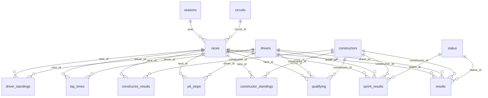

# Formula 1 PostgreSQL Database — Validation Report

**Date:** 2026-11-23  
**Database Name:** `f1`  
**Engine:** PostgreSQL 16.15 (Homebrew, port `5433`)  
**Dataset Source:** [Formula 1 World Championship (1950–2024)](https://www.kaggle.com/datasets/rohanrao/formula-1-world-championship-1950-2020) — Ergast F1 Dataset (`kagglehub` version 24)  
**Overall Validation Result:** **PASSED (6/6 course criteria + full technical integrity checks)**

---

## 1. Course Criteria Validation (*Les critères d'une base valide*)

| # | Criterion | Status | Evidence in `f1` Database |
| :- | :--- | :---: | :--- |
| 1 | **Au moins 4 à 5 tables reliées** *(At least 4–5 linked tables)* | **PASS** | **14 normalized tables** linked by **23 enforced foreign keys** and **14 primary keys** (exceeds minimum of 4–5 tables). |
| 2 | **Une dimension temporelle** *(Time dimension)* | **PASS** | **75 seasons** spanning **1950-05-13 to 2024-12-08** (`1,125` races), with `DATE` and `TIME` columns across races, FP1/FP2/FP3, qualifying, sprint sessions, driver birthdates (`dob`), pit stop timestamps, and lap durations in milliseconds. |
| 3 | **Des catégories ou groupes** *(Categories or groups)* | **PASS** | Rich categorical dimensions: **139** finish/retirement statuses (`status`), **212** constructors/teams (`constructors`), **43** driver nationalities, **24** constructor nationalities, and **35** circuit countries. |
| 4 | **Une hiérarchie** *(Hierarchy)* | **PASS** | Multiple natural multi-level hierarchies:<br>• **Temporal / Event:** `seasons` (year) → `races` (round) → `results` / `qualifying` / `pit_stops` / `lap_times`<br>• **Geographic:** `country` (35) → `location` / city (75) → `circuits` (77)<br>• **Organizational:** `constructors` (212 teams) → `drivers` (861 drivers, linked via `results` and `qualifying`) |
| 5 | **Du volume** *(Volume)* | **PASS** | **701,433 total rows** (**21 MB** raw CSVs, **89 MB** in PostgreSQL including indexes), led by `lap_times` (**589,081 rows**), `driver_standings` (**34,863 rows**), and `results` (**26,759 rows**). |
| 6 | **Une licence ouverte** *(Open license)* | **PASS** | Published under **CC0: Public Domain** on Kaggle (sourced from the Ergast Developer API) — explicitly permitted for educational/pedagogical use with source attribution. |

---

## 2. Schema & Relational Integrity



- **Tables:** 14
- **Primary Keys:** 14 (12 single-column PKs + 2 composite PKs on `pit_stops(race_id, driver_id, stop)` and `lap_times(race_id, driver_id, lap)`)
- **Foreign Keys:** 23 enforced constraints (0 orphan records)
- **Indexes:** 27 total (14 primary key indexes + 13 analytical indexes)
- **NULL Handling:** All `\N` markers in the source CSVs cleanly loaded as SQL `NULL`

---

## 3. Row-Count Parity & Storage Verification

Every CSV file was verified row-for-row against its loaded PostgreSQL table (**100% match, 0 dropped rows**):

| Table | CSV Rows | PostgreSQL Rows | Match | Data Size | Total Size (with Indexes) |
| :--- | ---: | ---: | :---: | ---: | ---: |
| `lap_times` | 589,081 | 589,081 | PASS | 34 MB | 67 MB |
| `driver_standings` | 34,863 | 34,863 | PASS | 2.3 MB | 4.2 MB |
| `results` | 26,759 | 26,759 | PASS | 2.7 MB | 4.1 MB |
| `constructor_standings` | 13,391 | 13,391 | PASS | 896 kB | 1.6 MB |
| `constructor_results` | 12,625 | 12,625 | PASS | 648 kB | 1.2 MB |
| `pit_stops` | 11,371 | 11,371 | PASS | 760 kB | 1.3 MB |
| `qualifying` | 10,494 | 10,494 | PASS | 832 kB | 1.3 MB |
| `races` | 1,125 | 1,125 | PASS | 160 kB | 304 kB |
| `drivers` | 861 | 861 | PASS | 160 kB | 208 kB |
| `sprint_results` | 360 | 360 | PASS | 48 kB | 72 kB |
| `constructors` | 212 | 212 | PASS | 24 kB | 48 kB |
| `status` | 139 | 139 | PASS | 8 kB | 32 kB |
| `circuits` | 77 | 77 | PASS | 16 kB | 40 kB |
| `seasons` | 75 | 75 | PASS | 8 kB | 32 kB |
| **Total** | **701,433** | **701,433** | **PASS** | — | **89 MB (full DB)** |

---

## 4. Sample Query Sanity Check

Verified multi-table joins (`results` ⋈ `drivers`, top 5 Grand Prix race winners):

| Driver | Wins |
| :--- | ---: |
| Lewis Hamilton | 105 |
| Michael Schumacher | 91 |
| Max Verstappen | 63 |
| Sebastian Vettel | 53 |
| Alain Prost | 51 |

---

## 5. Project Files & Export Archive

| File | Purpose | Size |
| :--- | :--- | ---: |
| `sql/schema.sql` | Full PostgreSQL DDL (14 tables, 14 PKs, 23 FKs, 13 analytical indexes) | — |
| `scripts/load_f1_db.py` | Reproducible Python script (loads from `data/csv/` or `kagglehub` via PostgreSQL `COPY`) | — |
| `dump/f1.dump` | Portable compressed `pg_dump` archive (`--no-owner --no-privileges`, verified all 14 tables) | 6.2 MB |

### Restore Command (for sharing)
```bash
createdb f1
pg_restore -d f1 --no-owner --no-privileges dump/f1.dump
```
