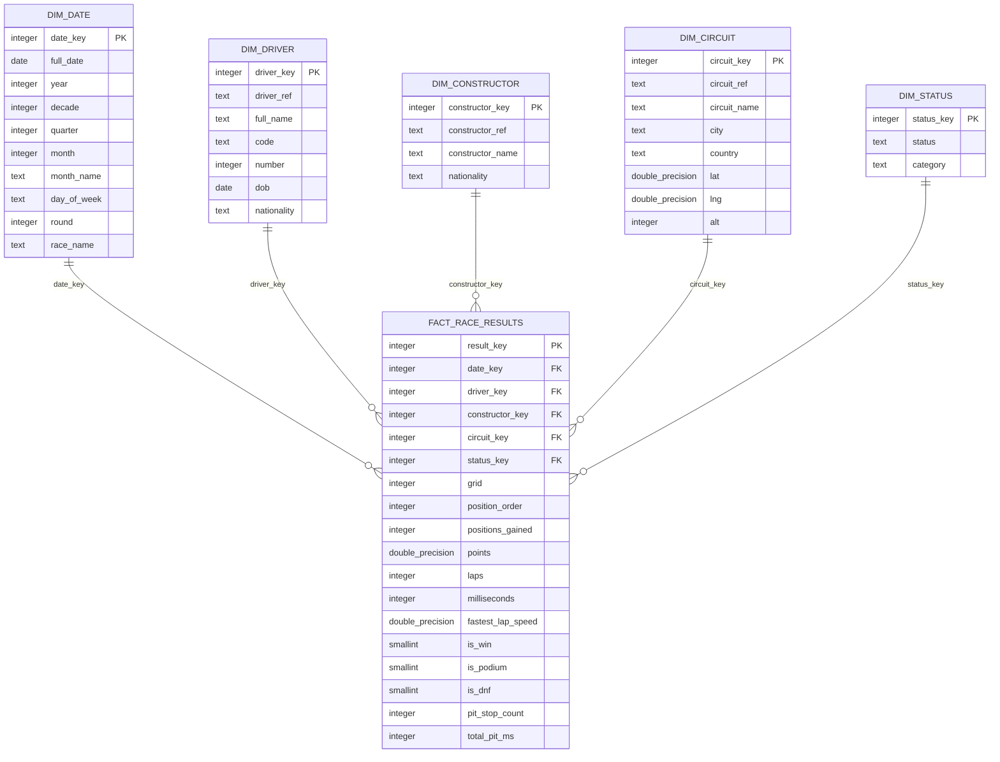

# Tâche 1 — Modèle en étoile et requêtes analytiques

**Base de données :** `f1`  
**Schéma source :** `public` (modèle relationnel 3NF)  
**Schéma analytique :** `dw` (schéma en étoile)  
**Scripts SQL :**

- [`queries_non_star.sql`](queries_non_star.sql) — requêtes sur le schéma normalisé `public`
- [`queries_star.sql`](queries_star.sql) — requêtes sur le schéma en étoile `dw`
- [`../../Other SQL/dw.sql`](../../Other%20SQL/dw.sql) — création du schéma `dw`

---

## 1. Objectif

Le schéma `public` est conçu pour garantir l'intégrité des données transactionnelles. Pour les analyses, il faut souvent effectuer plusieurs jointures entre les tables source.

La tâche consiste donc à :

1. extraire les données utiles du schéma `public` ;
2. les transformer en un modèle analytique ;
3. charger une table de faits centrale reliée à cinq dimensions ;
4. comparer des requêtes en SQL sur les deux modèles ;
5. utiliser des CTE, des fonctions fenêtre et une CTE récursive.

---

## 2. Schéma en étoile



---

## 3. Grain de la table de faits

La table `dw.fact_race_results` possède le grain suivant :

> **Une ligne = un pilote dans un Grand Prix.**

Elle contient 26 759 lignes après chargement. La clé primaire est `result_key`, correspondant à `results.result_id` dans le schéma source.

Chaque ligne est reliée à :

- une date/course via `date_key` ;
- un pilote via `driver_key` ;
- une écurie via `constructor_key` ;
- un circuit via `circuit_key` ;
- un statut d'arrivée via `status_key`.

Les cinq colonnes indicatrices suivantes sont calculées lors du chargement :

| Colonne | Définition |
| :--- | :--- |
| `is_win` | `1` si `position = 1`, sinon `0` |
| `is_podium` | `1` si `position` est entre 1 et 3, sinon `0` |
| `is_dnf` | `1` si `position` est nul, sinon `0` |
| `pit_stop_count` | nombre d'arrêts aux stands agrégé |
| `total_pit_ms` | somme des durées d'arrêts aux stands |

---

## 4. Dimension temporelle

`dim_date` est construite à partir de la table `public.races`. Elle contient une ligne par course avec :

- la date complète ;
- l'année ;
- la décennie ;
- le trimestre ;
- le mois ;
- le nom du mois ;
- le jour de la semaine ;
- le tour ;
- le nom du Grand Prix.

Cette dimension permet des analyses mensuelles, trimestrielles, annuelles ou par décennie sans joindre directement les données brutes des courses.

---

## 5. Transformation des données

Le chargement analytique suit une logique ELT :

1. création du schéma `dw` ;
2. extraction des dimensions depuis les tables normalisées ;
3. regroupement des colonnes descriptives dans les dimensions ;
4. agrégation des arrêts aux stands par course et par pilote ;
5. construction de la table de faits à partir de `public.results` ;
6. ajout des clés primaires et des clés étrangères ;
7. création des index sur les clés étrangères de la table de faits.

### Agrégation des arrêts aux stands

Avant la création de la table de faits, les arrêts sont regroupés avec :

```sql
SELECT
    race_id,
    driver_id,
    COUNT(*) AS pit_stop_count,
    SUM(milliseconds) AS total_pit_ms
FROM public.pit_stops
GROUP BY race_id, driver_id;
```

Cette agrégation est reliée à la table de faits par `LEFT JOIN`, afin de conserver les résultats des pilotes n'ayant effectué aucun arrêt enregistré.

---

## 6. Requêtes réalisées

Les six requêtes demandées sont disponibles dans les deux fichiers SQL.

| Requête | Fonction principale | Schéma star | Schéma non-star |
| :--- | :--- | :---: | :---: |
| Top 3 pilotes par écurie | `ROW_NUMBER()` | `dw.fact_race_results` | `public.results` |
| Évolution mensuelle des points | `LAG()` | `dim_date` | `public.races` |
| Quartiles des pilotes | `NTILE(4)` | `dim_driver` | `public.drivers` |
| Hiérarchie pays > ville > circuit | CTE récursive | `dim_circuit` | `public.circuits` |
| Délai moyen entre deux courses | `LAG()` | `dim_driver` + `dim_date` | `public.results` + `races` |
| Statuts par décennie | Fenêtre + agrégation | `dim_status` + `dim_date` | — |

### Requête star schema — exemple

```sql
SELECT
    dt.decade,
    s.category AS status_category,
    COUNT(*) AS race_entries,
    ROUND(
        COUNT(*) * 100.0 /
        SUM(COUNT(*)) OVER (PARTITION BY dt.decade),
        2
    ) AS pct_of_decade
FROM dw.fact_race_results f
JOIN dw.dim_date dt
    ON dt.date_key = f.date_key
JOIN dw.dim_status s
    ON s.status_key = f.status_key
GROUP BY dt.decade, s.category
ORDER BY dt.decade DESC, race_entries DESC;
```

Cette requête combine les avantages du modèle en étoile :

- peu de tables à joindre ;
- accès direct à des attributs analytiques comme `decade` et `category` ;
- agrégation simple sur la table de faits ;
- fenêtre utilisée pour calculer la part dans la décennie.

---

## 7. Comparaison des modèles

| Critère | Schéma normalisé `public` | Schéma en étoile `dw` |
| :--- | :--- | :--- |
| Structure | Plusieurs tables relationnelles normalisées | Une fact table reliée à cinq dimensions |
| Redondance | Faible | Modérée dans les dimensions |
| Jointures | Souvent plus nombreuses | Réduites et plus simples |
| Attributs analytiques | Stockés dans plusieurs tables | Centralisés dans les dimensions |
| Maintenance | Plus adaptée aux écritures | Plus adaptée aux consultations analytiques |
| Requêtes BI | Plus complexes | Plus lisibles et faciles à utiliser |

Le schéma en étoile ne remplace pas le schéma normalisé. Il est construit à partir de celui-ci pour répondre efficacement aux besoins d'analyse.

---

## 8. Contraintes d'intégrité

La table de faits possède cinq contraintes de clé étrangère :

- `date_key -> dim_date.date_key`
- `driver_key -> dim_driver.driver_key`
- `constructor_key -> dim_constructor.constructor_key`
- `circuit_key -> dim_circuit.circuit_key`
- `status_key -> dim_status.status_key`

Chaque dimension possède une clé primaire. Un index est créé sur chaque clé étrangère de la table de faits afin d'accélérer les jointures analytiques.
